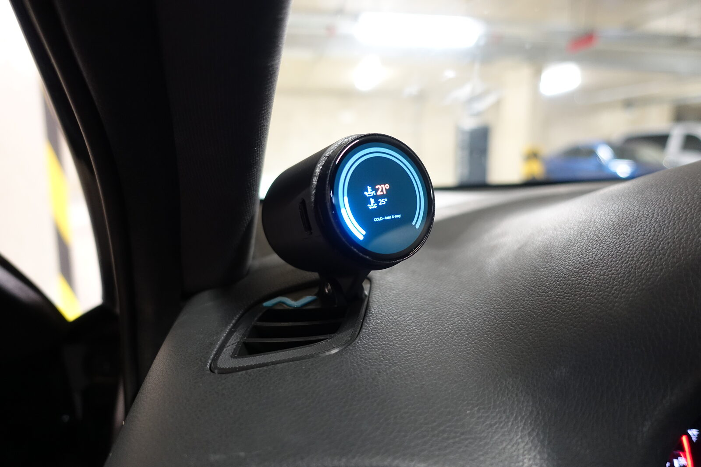
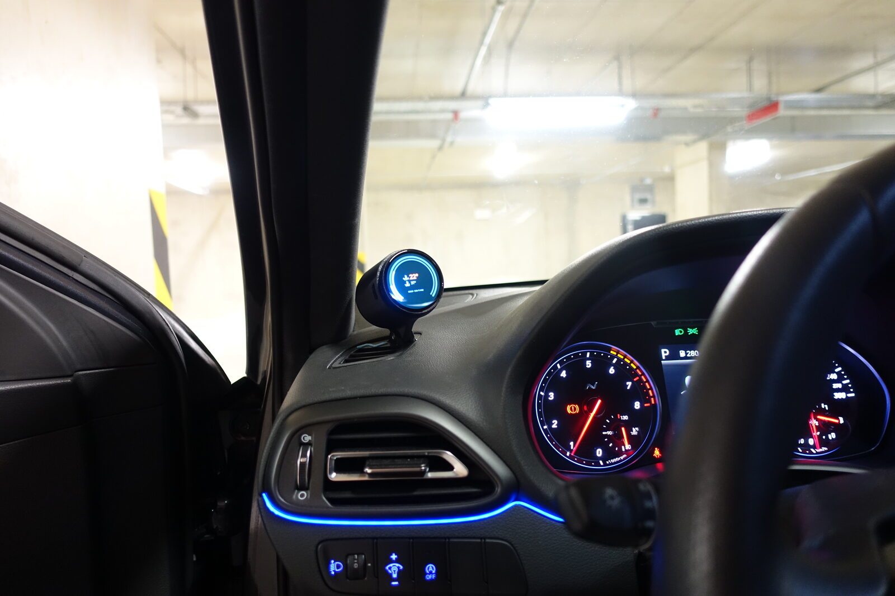
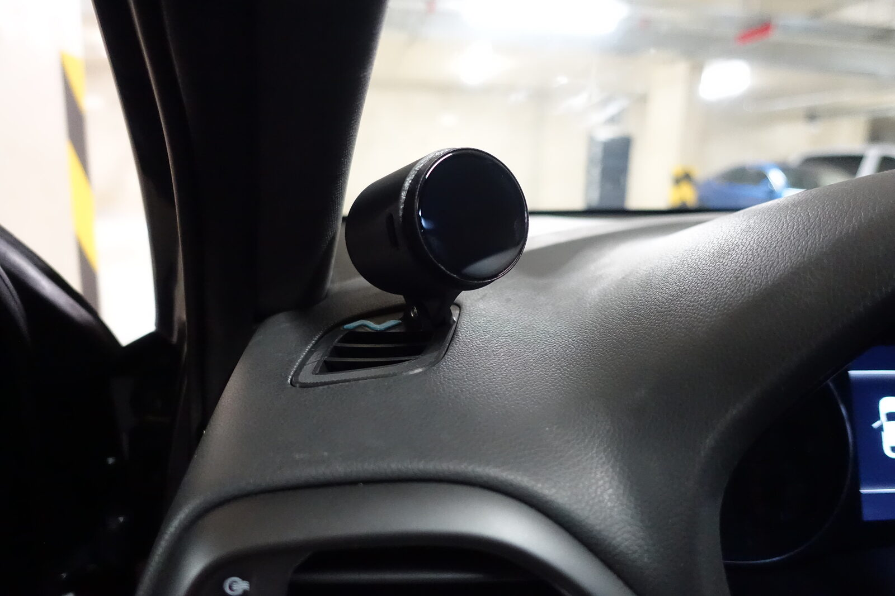
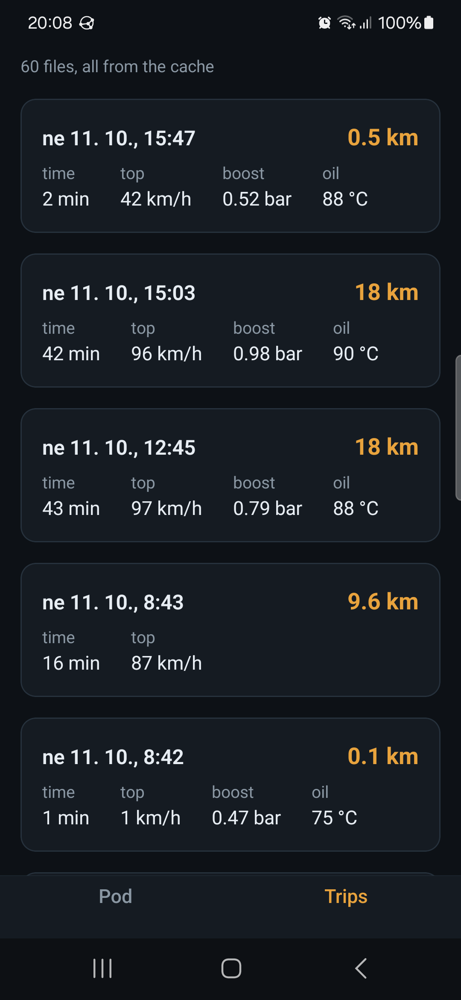
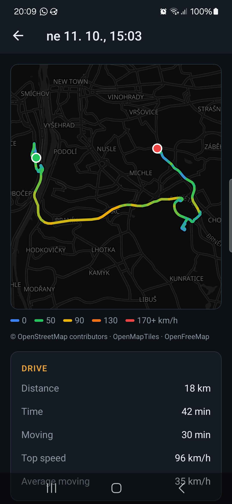
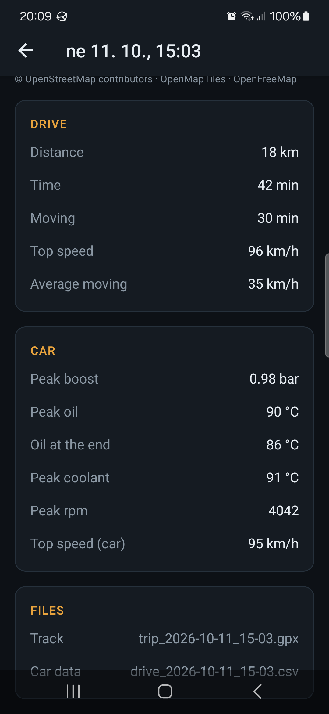
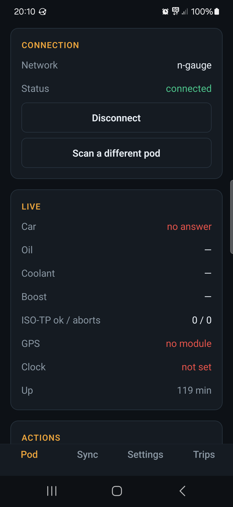

# N Gauge



A round AMOLED gauge that lives in the driver-side air vent of a **Hyundai
i30 N**, reading the car live over the OBD-II port: **oil temperature** - the
number the car's own dashboard hides behind a menu - plus coolant, boost, tyre
pressures, a g-meter, GPS speed and a lap timer. It logs every drive to an SD
card, and a phone app pulls the logs off it and shows each drive on a map.

Everything here was built for one car and is in daily use in it. It is a
hobby project, published in case the findings, the code or the approach help
someone with the same car or the same board.

<p>


</p>

*From the driver's seat, beside the car's own cluster; and switched off - the
3D-printed housing replaces the left air vent's surround.*

<p>




</p>

*The phone app: trips, a drive's track coloured by speed, its stats, the
pod's live readings (on the bench, hence "no answer").*

## What it does

- **Gauges:** oil and coolant (concentric arcs, with a cold-engine "not
  ready" state and over-temperature warnings), boost, a g-meter, the four tyre
  pressures and temperatures, GPS speed and trip distance, a lap timer.
- **Logging:** a CSV of every drive (2 Hz, decoded values plus the raw
  payloads), a GPX track at 25 Hz, a sleep log.
- **Power:** deep sleep when the car goes quiet, ~11 mA parked (about 57
  days on the battery); wakes on CAN activity, the button, or the door
  opening (the IMU's wake-on-motion).
- **Phone:** its own WiFi access point with settings pages, OTA firmware
  updates with rollback, and an Android app ([mobile/](mobile)) that joins it
  from a QR code on the gauge, syncs the logs, and shows trips on a map.

## Hardware

| Part | |
|---|---|
| Waveshare ESP32-S3-Touch-AMOLED-1.75 | 466×466 round AMOLED, touch, IMU, PMU, SD slot |
| SN65HVD230 | CAN transceiver, on OBD pins 6 and 14 |
| u-blox NEO-M9N | GNSS, 25 Hz |
| TPS5430 buck | 12 V → 5 V from OBD pin 16 |
| 3D-printed vent pod | replaces the left air vent; STLs in [mechanical/pod](mechanical/pod) |
| carrier PCB | KiCad, in [hardware/carrier](hardware/carrier) - replaces the breakout boards |

## Things worked out about the i30 N

Most of this took real drives and a lot of wrong turns; the reasoning, and
the wrong turns, are in [DECISIONS.md](DECISIONS.md).

- **Oil temperature is byte 34** of the Mode 22 reply to DID `0xE001` (engine
  ECU, `0x7E0`): `°C = raw × 0.7435 − 49.2`, matched against the dashboard up
  to 100 °C. Mode 01 PID `0x5C` is not supported. Byte 25 of the same reply
  *looks* like oil but is coolant-derived - and correlating bytes against the
  coolant curve picks it, which is how it was wrongly used for weeks.
- **Coolant as the dashboard shows it** is byte 25 of that reply, a few
  degrees below PID `0x05`.
- **Tyre pressures and temperatures** come from the TPMS module (`0x7A0`,
  DID `0xC00B`), not the ECU.
- **The OBD port is behind a gateway:** no broadcast traffic reaches it, only
  replies to requests - so brake, pedal and steering cannot be read passively
  there.
- **Gear** is derived from rpm ÷ speed; the measured ratios are in
  `config.h`.

## Repository

| Path | |
|---|---|
| [firmware/car_gauge_v1](firmware/car_gauge_v1) | the gauge firmware (Arduino, ESP32 core 3.x, LVGL 9) |
| [mobile](mobile) | the Android app (Expo / React Native) |
| [backend](backend) | a small log store the app can upload to (Node, Docker) - optional |
| [tests](tests) | host tests of the firmware's pure logic |
| [hardware](hardware), [mechanical](mechanical) | carrier PCB, 3D-printed parts |
| [DECISIONS.md](DECISIONS.md) | why things are the way they are |
| [PROTOTYPE_GUIDE.md](PROTOTYPE_GUIDE.md), [PRINTING_GUIDE.md](PRINTING_GUIDE.md) | wiring the prototype; printing the pod |

## Building

Firmware ([details](firmware/car_gauge_v1/README.md)):

```sh
./scripts/setup-libs.sh          # Arduino core, pinned libraries, lv_conf
./scripts/build.sh gauge flash   # compile and flash over USB
./scripts/test.sh                # host tests
```

App ([details](mobile/README.md)):

```sh
cd mobile && ./scripts/build-apk.sh install   # release APK onto a phone over adb
```

## Caveats

- **Not affiliated with Hyundai.** "Hyundai", "i30 N" and the N badge used in
  the boot screen and the app icon are Hyundai's trademarks; they appear here
  only to say which car this is for.
- The gauge only **reads** - standard OBD and diagnostic requests, nothing
  that writes to the car. Still: it is your car, your OBD port and your
  responsibility, and a device on the dash must not distract from driving or
  sit in an airbag's path.
- Built and tested on one car, a European i30 N Fastback. Other model years
  or markets may answer differently.

## Licence

[MIT](LICENSE). Third-party assets keep their own licences - see
[firmware/assets/README.md](firmware/assets/README.md).
