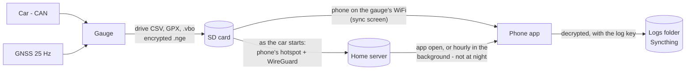
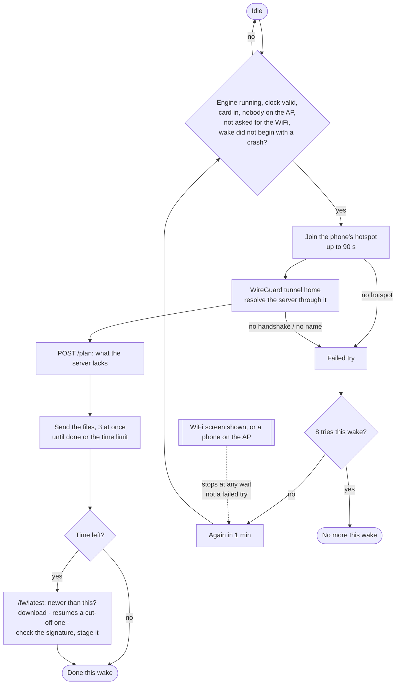
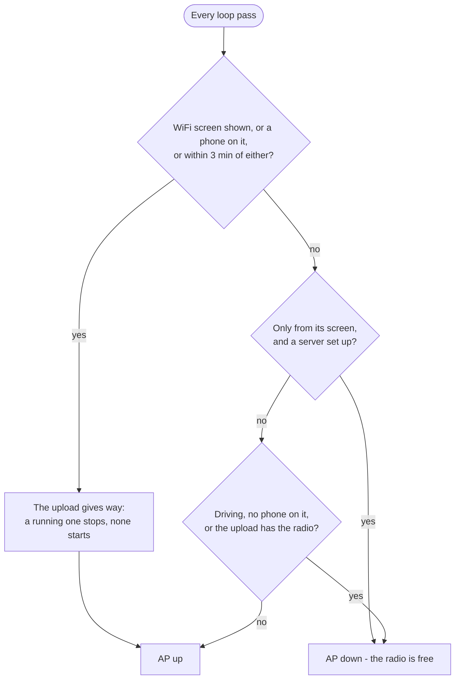
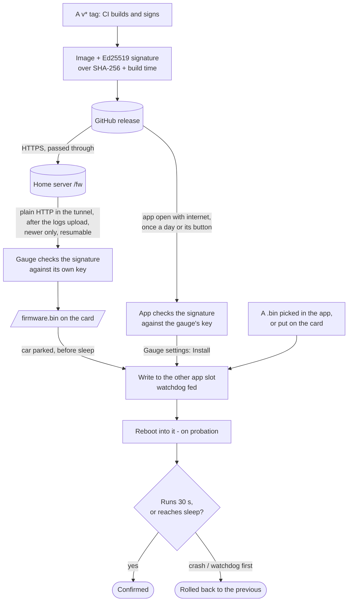
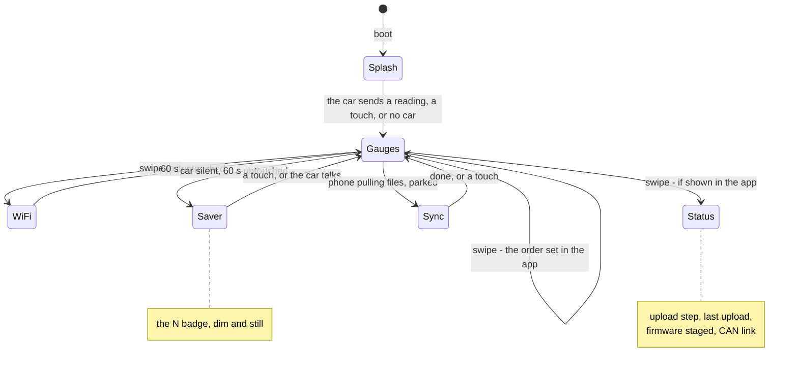
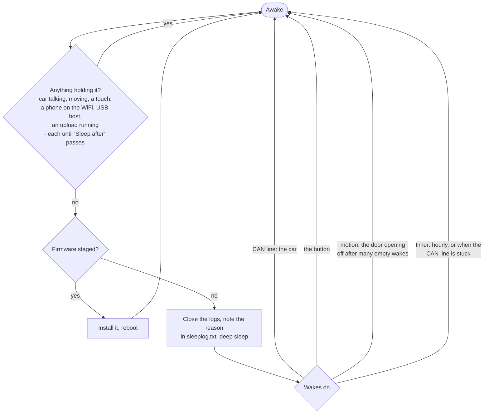

# How the gauge decides

The gauge's processes as diagrams - [Mermaid](https://mermaid.js.org), which
GitHub draws from the text below. Edit the text with the code it describes,
in the same commit; there is nothing to regenerate. Each names the file that
holds the real rules.

- [Where the logs go](#where-the-logs-go)
- [The log upload](#the-log-upload)
- [The gauge's WiFi](#the-gauges-wifi)
- [Firmware updates](#firmware-updates)
- [The screens](#the-screens)
- [Sleep and wake](#sleep-and-wake)

## Where the logs go

Every drive is written to the gauge's SD card, encrypted to the phone's key,
and leaves it two ways: by itself to the home server as the car starts, and to
the phone over the gauge's WiFi. The phone reads them from either.

## The log upload

`firmware/car_gauge_v1/upload.cpp`. Logs first, then a new firmware with the
time they left.

## The gauge's WiFi

`firmware/car_gauge_v1/car_gauge_v1.ino`, `apTask`. With a home server set up
(setting "Gauge WiFi only from its screen", on by default) it is up only when
asked for; without one, whenever the gauge is awake and the car not driving.

## Firmware updates

`firmware/car_gauge_v1/ota.cpp`, `upload.cpp`, `mobile/src/lib/fw-download.ts`.
Every update is checked before it runs, and a new firmware is on probation: a
crash or a watchdog before it confirms itself boots the previous one again.

## The screens

`firmware/car_gauge_v1/car_gauge_v1.ino` (`bootSplashTask`, `syncTask`,
`saverTask`, `viewTask`), `ui.cpp`.

## Sleep and wake

`firmware/car_gauge_v1/podstate.h` (what holds sleep off), `power.cpp` (how it
sleeps and what wakes it). Deep sleep draws ~11 mA.

