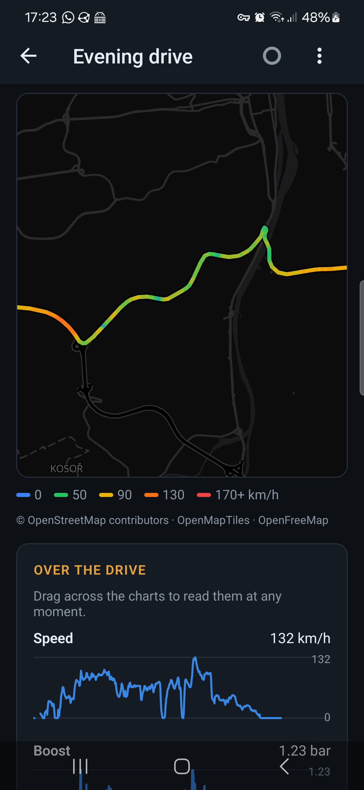
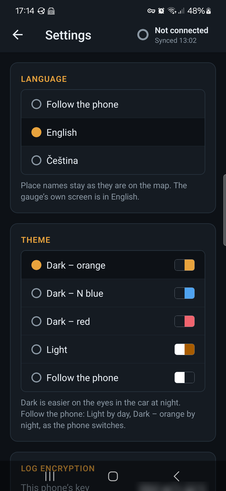
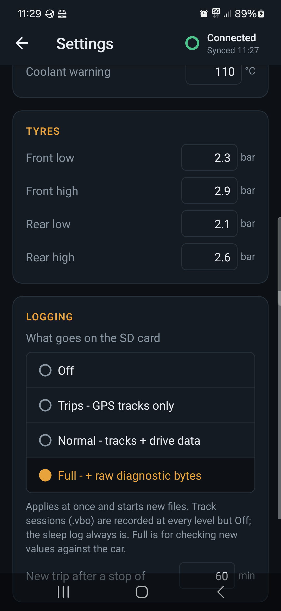

# N Gauge — phone app

Expo (SDK 57) app for the gauge: a tap on it pulls the logs off its card -
then the phone leaves its WiFi again - and shows every drive, named after
where it went, grouped by week, with its track on a map and its readings as
charts. It decrypts encrypted logs, saves them to a folder, deletes a drive
from the phone and the gauge alike, and edits the gauge's settings and
updates its firmware. English or Czech; dark themes or light.

## Screenshots

Galaxy S22, 2026-10-14; the drives are real ones, their place names
swapped for made-up ones and the map zoomed away from both ends.

| | | |
|---|---|---|
|  |  |  |
| The main screen: every drive, named after where it went, by week. The gauge sits in the header, like a watch in Garmin Connect | A drive: the track, coloured by speed | Its readings over the drive - drag to read them at any moment |
|  |  | |
| Settings: language, theme, log encryption, your places | The gauge's own settings (an older shot, from before Gauge settings was the gauge's one screen) | |

Android only. Joining the gauge's AP from an app needs `WifiNetworkSpecifier`,
which is what the local module `modules/pod-wifi` wraps; iOS has no equivalent
that can be relied on, and the web build is only for working on screens (it
assumes the computer is already on the gauge's AP). The code still calls the
gauge "the pod" (`usePod`, `pod.ts`, `PodChip`); the app says gauge.

## How it talks to the gauge

- **Joining:** `PodWifi.connect(ssid, pass)` shows Android's one-tap "connect
  to this device" prompt. The phone keeps mobile data as its default network.
- **Routing:** while connected, the whole app process is bound to the gauge's
  network (`bindProcessToNetwork`), so `fetch` and downloads reach
  `http://4.3.2.1`. ⚠ That also means the app has **no internet** - no map
  tiles - until `disconnect()`, which it does once a sync is done (unless a
  screen that needs the gauge is open: `useHoldPod`).
- **Credentials:** scanned once from the QR on the gauge's WiFi screen, kept in
  SecureStore.
- **Endpoints used:** `/api/live`, `/api/settings`, `/save` (form-encoded,
  keyed by the form names - see `src/lib/settings-schema.ts`), `/api/clock`,
  `/update`, `/api/files` (the card, paged JSON), `/dl` (with `Range`, for
  a log that grew since the last sync), `/api/delete` (a drive's logs, from
  the app's Delete).
- **Deleting:** a drive deleted on the phone goes on a delete-on-gauge list;
  every sync deletes those on the gauge first and never pulls them back
  meanwhile - so deleting while not connected just waits for the next
  connect.
- **Sync:** on every connect, from any screen (`src/hooks/use-sync.tsx`):
  list the card, pull what is new or grew, then leave the gauge's WiFi and
  say in a toast what came over. The gauge serves one request at a time, so
  saving settings or a firmware upload stops a sync first.
- **Pairing a drive's files:** every log's name ends in the session (the
  gauge's boot or wake) that wrote it - `trip_2026-10-12_21-19_3fa81c.gpx` -
  and a GPX goes with the CSV of its session.

## Layout

| Path | What |
|---|---|
| `src/app/index.tsx` | N Gauge: every drive on the phone, by week - the main screen, no tabs |
| `src/app/trip/[key].tsx` | A drive: map, charts, stats; rename, share, save or delete it |
| `src/app/name.tsx` | Naming a drive, or one of its ends as a place of yours |
| `src/app/gauge-settings.tsx` | The gauge's one screen: setting it up, its settings, screens' order, firmware, system, clock, g-meter zero - connects by itself |
| `src/app/settings.tsx` | The phone's: language, theme, log encryption, logs folder, your places |
| `src/app/scan.tsx` | QR scan for the WiFi credentials |
| `src/components/pod-chip.tsx` | The gauge in the header: connection and sync at a glance; a tap syncs |
| `src/components/drive-chart.tsx` | Speed, boost, temperatures, voltage over a drive (react-native-svg) |
| `src/hooks/use-sync.tsx` | The sync, run by itself on every connect; leaving the gauge's WiFi after |
| `src/lib/pod.ts` | HTTP client for the gauge |
| `src/lib/store.ts` | Credentials, the inbox (the pulled logs), the delete-on-gauge list |
| `src/lib/trip-cache.ts` | Each log's summary, thinned track and chart series, cached by size |
| `src/lib/trips.ts` | Parsing GPX / CSV, pairing a drive's files by session - pure, tested |
| `src/lib/series.ts`, `weeks.ts` | A drive's readings for the charts; the list's weeks - pure, tested |
| `src/lib/places.ts`, `names.ts` | Naming a drive from the place lists and your own places |
| `assets/places/` | GeoNames place lists, CZ and neighbours (`scripts/make-places.ts`) |
| `src/lib/sync-plan.ts` | What to pull, by `{name, size}` - pure, tested |
| `src/lib/settings-schema.ts` | ⚠ Copy of the firmware's `settings_table` - change both |
| `src/i18n/` | The app's words: English as the key, Czech in `cs/` |
| `src/theme.ts` | The themes' colours; `useColors()` and `themed()` styles |
| `modules/pod-wifi` | Kotlin: WifiNetworkSpecifier + process binding |

## Words and colours

- **Text** goes through `t('English text')` (`src/i18n`): the English is the
  key, the Czech lives in `src/i18n/cs/`. Counts are `tn(n, '1 drive',
  '{n} drives')` - Czech has three forms. Text in a table built at load time
  is marked `N_('...')` and shown with `t()`. `npm test` fails on any text
  without its Czech, or with placeholders that differ.
- **Colours** come from `useColors()`, styles from `themed((C) =>
  StyleSheet.create(...))` - never a StyleSheet with colours made at import,
  which would keep the first theme's.

## Run

Expo Go does not have the native module, so it is always a build of its own.
Needs JDK 17+ and the Android SDK.

**For the phone (the usual way):** a release APK, which carries its own JS
and so runs in the car with no computer.

```sh
./scripts/build-apk.sh install   # npm install / prebuild if needed, build, adb install, start
```

It sets `ANDROID_HOME` and `JAVA_HOME` (this machine's default java is 8),
builds arm64 only, and puts the build output on another disk: every Android
module's `build/` becomes a symlink into `BUILD_ROOT` (default
`/data/cache/n-gauge-build` where `/data` exists; `BUILD_ROOT=` keeps it in
place). That is ~2.4 GB, most of it native packages' builds inside
`node_modules`. The script says why it is symlinks and not Gradle's buildDir.

**While working on screens:** a debug build loads its JS from Metro over the
USB cable, with hot reload - the phone must stay plugged in.

```sh
npx expo run:android   # builds, installs over adb, starts Metro
```

After changing anything under `modules/` rebuild; JS changes hot-reload.

## Check

```sh
npm test            # node:test on src/lib and src/i18n (no React Native needed)
npm run typecheck
npm run lint
```
