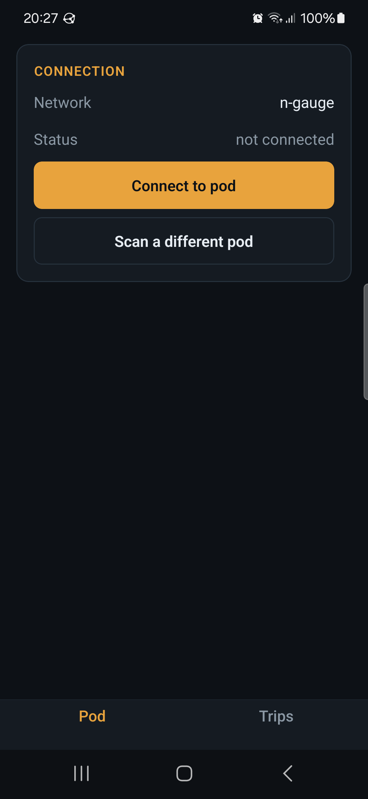
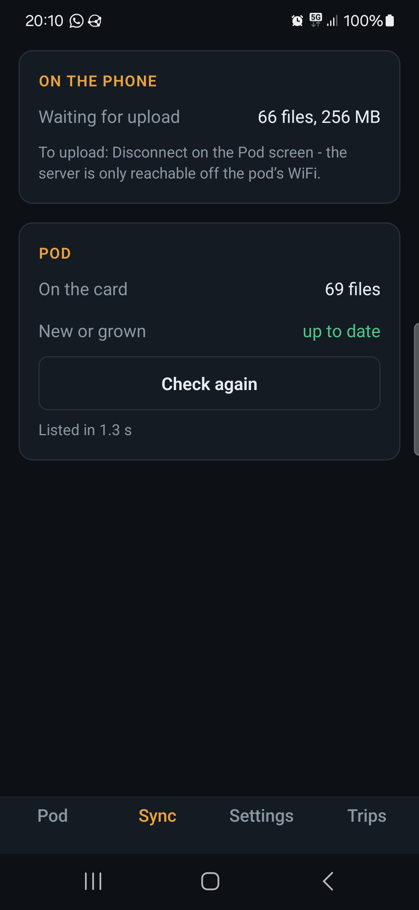
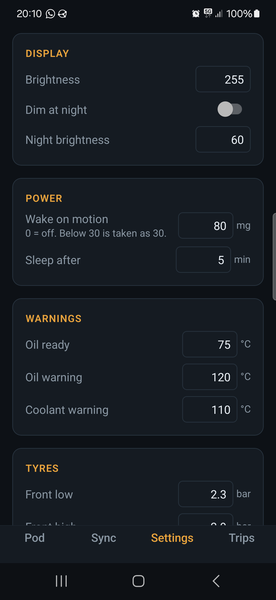
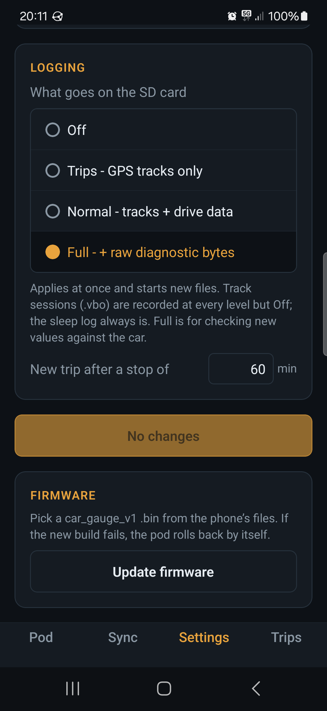
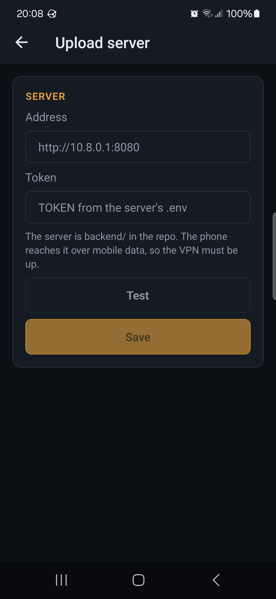

# N Gauge — phone app

Expo (SDK 57) app for the pod: joins its WiFi, shows live status, edits its
settings, updates its firmware, pulls the logs off its card, shows each
drive's stats and track on a map, and uploads the logs to
[backend/](../backend).

## Screenshots

Galaxy S22, 2026-10-11, on the bench (hence "Car: no answer"); the drive is
a real one from that afternoon.

| | | | |
|---|---|---|---|
|  |  |  |  |
| Pod, off its WiFi | Pod, connected: live status | Sync: pull what is new | Trips: every drive on the phone |
|  |  |  |  |
| A drive: the track, coloured by speed | GPS and car stats | Settings: the pod's table | Log level, firmware upload |
|  | | | |
| Upload server (switched off for now, see `src/features.ts`) | | | |

Android only. Joining the pod's AP from an app needs `WifiNetworkSpecifier`,
which is what the local module `modules/pod-wifi` wraps; iOS has no equivalent
that can be relied on, and the web build is only for working on screens (it
assumes the computer is already on the pod's AP).

## How it talks to the pod

- **Joining:** `PodWifi.connect(ssid, pass)` shows Android's one-tap "connect
  to this device" prompt. The phone keeps mobile data as its default network.
- **Routing:** while connected, the whole app process is bound to the pod's
  network (`bindProcessToNetwork`), so `fetch` and downloads reach
  `http://4.3.2.1`. ⚠ That also means the app has **no internet** until
  `disconnect()` - a sync pulls first, then disconnects, then uploads.
- **Credentials:** scanned once from the QR on the pod's WiFi screen, kept in
  SecureStore.
- **Endpoints used:** `/api/live`, `/api/settings`, `/save` (form-encoded,
  keyed by the form names - see `src/lib/settings-schema.ts`), `/api/clock`,
  `/update`, `/dl`. Still to add on the pod: `GET /api/files` (JSON list) and
  `Range` on `/dl` - Sync cannot list the card until those are flashed.

## Layout

| Path | What |
|---|---|
| `src/app/(tabs)/index.tsx` | Pod: connect, live status, clock, g-meter zero |
| `src/app/(tabs)/sync.tsx` | Pull new/grown files from the card into the phone's inbox |
| `src/app/(tabs)/settings.tsx` | The pod's settings table, firmware upload |
| `src/app/scan.tsx` | QR scan for the WiFi credentials |
| `src/lib/pod.ts` | HTTP client for the pod |
| `src/lib/store.ts` | Credentials and the inbox (pulled, not yet uploaded) |
| `src/lib/sync-plan.ts` | What to pull, by `{name, size}` - pure, tested |
| `src/lib/settings-schema.ts` | ⚠ Copy of the firmware's `settings_table` - change both |
| `modules/pod-wifi` | Kotlin: WifiNetworkSpecifier + process binding |

## Run

Expo Go does not have the native module, so it is always a build of its own.
Needs JDK 17+ and the Android SDK.

**For the phone (the usual way):** a release APK, which carries its own JS
and so runs in the car with no computer.

```sh
./scripts/build-apk.sh install   # npm install / prebuild if needed, build, adb install, start
```

It sets `ANDROID_HOME` and `JAVA_HOME` (this machine's default java is 8),
builds arm64 only, and puts the build output on another disk: every Android
module's `build/` becomes a symlink into `BUILD_ROOT` (default
`/data/cache/n-gauge-build` where `/data` exists; `BUILD_ROOT=` keeps it in
place). That is ~2.4 GB, most of it native packages' builds inside
`node_modules`. The script says why it is symlinks and not Gradle's buildDir.

**While working on screens:** a debug build loads its JS from Metro over the
USB cable, with hot reload - the phone must stay plugged in.

```sh
npx expo run:android   # builds, installs over adb, starts Metro
```

After changing anything under `modules/` rebuild; JS changes hot-reload.

## Check

```sh
npm test            # node:test on src/lib (no React Native needed)
npm run typecheck
npm run lint
```
