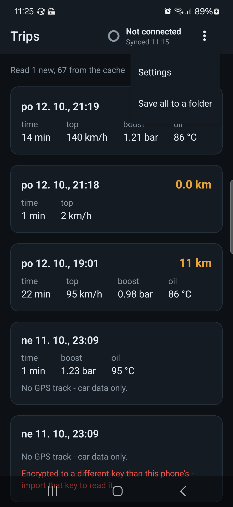
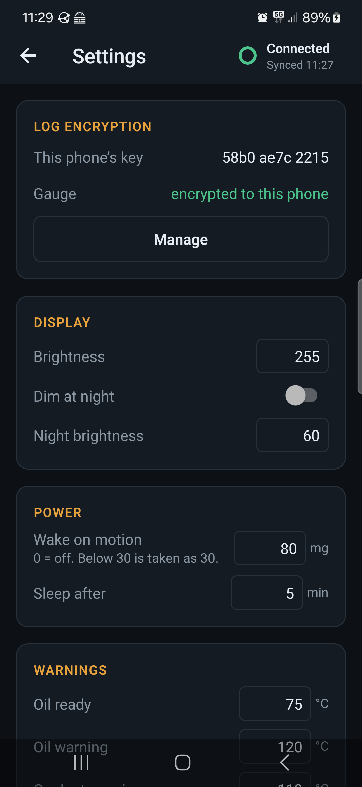

# N Gauge — phone app

Expo (SDK 57) app for the gauge: joins its WiFi, pulls the logs off its card
by itself, shows each drive's stats and track on a map, decrypts encrypted
logs, shows the gauge's live status, edits its settings and updates its
firmware. Uploading the logs to [backend/](../backend) is built but switched
off (`src/features.ts`).

## Screenshots

Galaxy S22, 2026-10-13, the gauge on the bench (hence "Car: no answer"); the
drives are real ones.

| | | |
|---|---|---|
|  |  |  |
| Trips, the app's main screen. The gauge sits in the header, like a watch in Garmin Connect: its connection and when it last synced | A drive: the track, coloured by speed, and its stats | Tap the gauge: connection, the log sync (automatic on every connect), live status |
|  |  |  |
| ⋮: Settings, and saving every log decrypted to a folder | Settings: log encryption, then the gauge's own settings | Log level, warnings, tyres, firmware upload |

Android only. Joining the gauge's AP from an app needs `WifiNetworkSpecifier`,
which is what the local module `modules/pod-wifi` wraps; iOS has no equivalent
that can be relied on, and the web build is only for working on screens (it
assumes the computer is already on the gauge's AP). The code still calls the
gauge "the pod" (`usePod`, `pod.ts`, `PodChip`); the app says gauge.

## How it talks to the gauge

- **Joining:** `PodWifi.connect(ssid, pass)` shows Android's one-tap "connect
  to this device" prompt. The phone keeps mobile data as its default network.
- **Routing:** while connected, the whole app process is bound to the gauge's
  network (`bindProcessToNetwork`), so `fetch` and downloads reach
  `http://4.3.2.1`. ⚠ That also means the app has **no internet** - no map
  tiles - until `disconnect()`.
- **Credentials:** scanned once from the QR on the gauge's WiFi screen, kept in
  SecureStore.
- **Endpoints used:** `/api/live`, `/api/settings`, `/save` (form-encoded,
  keyed by the form names - see `src/lib/settings-schema.ts`), `/api/clock`,
  `/update`, `/api/files` (the card, paged JSON), `/dl` (with `Range`, for
  a log that grew since the last sync).
- **Sync:** on every connect, from any screen (`src/hooks/use-sync.tsx`):
  list the card, pull what is new or grew. The gauge serves one request at a
  time, so the live readout pauses meanwhile, and saving settings or a
  firmware upload stops it first.
- **Pairing a drive's files:** every log's name ends in the session (the
  gauge's boot or wake) that wrote it - `trip_2026-10-12_21-19_3fa81c.gpx` -
  and a GPX goes with the CSV of its session.

## Layout

| Path | What |
|---|---|
| `src/app/index.tsx` | Trips: every drive on the phone - the main screen, no tabs |
| `src/app/trip/[key].tsx` | A drive: map, stats, share or save its logs |
| `src/app/gauge.tsx` | The gauge: connect, the log sync, live status, clock, g-meter zero |
| `src/app/settings.tsx` | Log encryption; the gauge's settings table, firmware upload |
| `src/app/scan.tsx` | QR scan for the WiFi credentials |
| `src/components/pod-chip.tsx` | The gauge in the header: connection and sync at a glance |
| `src/hooks/use-sync.tsx` | The sync, run by itself on every connect |
| `src/lib/pod.ts` | HTTP client for the gauge |
| `src/lib/store.ts` | Credentials and the inbox (the pulled logs) |
| `src/lib/trips.ts` | Parsing GPX / CSV, pairing a drive's files by session - pure, tested |
| `src/lib/sync-plan.ts` | What to pull, by `{name, size}` - pure, tested |
| `src/lib/settings-schema.ts` | ⚠ Copy of the firmware's `settings_table` - change both |
| `modules/pod-wifi` | Kotlin: WifiNetworkSpecifier + process binding |

## Run

Expo Go does not have the native module, so it is always a build of its own.
Needs JDK 17+ and the Android SDK.

**For the phone (the usual way):** a release APK, which carries its own JS
and so runs in the car with no computer.

```sh
./scripts/build-apk.sh install   # npm install / prebuild if needed, build, adb install, start
```

It sets `ANDROID_HOME` and `JAVA_HOME` (this machine's default java is 8),
builds arm64 only, and puts the build output on another disk: every Android
module's `build/` becomes a symlink into `BUILD_ROOT` (default
`/data/cache/n-gauge-build` where `/data` exists; `BUILD_ROOT=` keeps it in
place). That is ~2.4 GB, most of it native packages' builds inside
`node_modules`. The script says why it is symlinks and not Gradle's buildDir.

**While working on screens:** a debug build loads its JS from Metro over the
USB cable, with hot reload - the phone must stay plugged in.

```sh
npx expo run:android   # builds, installs over adb, starts Metro
```

After changing anything under `modules/` rebuild; JS changes hot-reload.

## Check

```sh
npm test            # node:test on src/lib (no React Native needed)
npm run typecheck
npm run lint
```
