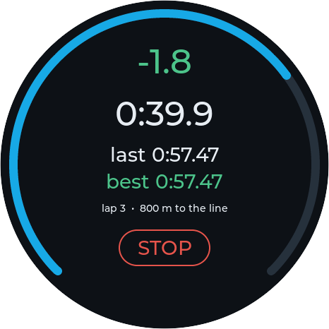

# The gauge on a PC



The gauge firmware built for Linux: its own `setup()` and `loop()`
([car_gauge_v1.ino](../firmware/car_gauge_v1/car_gauge_v1.ino)) and its own
screens ([ui.cpp](../firmware/car_gauge_v1/ui.cpp)), unchanged, in a
466x466 window through LVGL's SDL driver - fed a recorded drive instead of
the car. Not chip emulation: the board is stood in for
([sim_hw.cpp](sim_hw.cpp), [stubs/](stubs)), and the drive's CSV goes into
the car's state as the CAN task would fill it, its GPX into the GPS.

For working on the screens without flashing, and for the lap timer on real
(or made-up) laps at a desk.

## Running

Needs CMake, a C++ compiler, SDL2 and LVGL where the firmware build keeps it
(`scripts/setup-libs.sh`).

```sh
sim/run.sh                                     # the newest drive in data/
sim/run.sh data/drive_X.csv data/trip_X.gpx    # a given one (either, or both)
```

The mouse is the finger: click to tap, drag sideways to swipe.

| Key | |
|---|---|
| space | pause / go on |
| 1 2 3 | 1x, 5x, 20x speed |
| ← → | 30 s back / forward |
| u | a PC on USB (the bench page, Share SD card) |
| q, esc | quit |

The window is a fixed-size dialog, so tiling window managers (i3) float it.
Settings start from the defaults every run, as on a freshly erased gauge;
WiFi, the SD card and sleep are left out.

## A track session

The recorded drives are city streets. For laps,
[scripts/make_track_gpx.py](../scripts/make_track_gpx.py) writes a made-up
session - a 2.7 km circuit over an empty field, an out-lap, five timed laps
(one with a mistake), an in-lap - as a GPX and a drive log, and prints each
lap's true time:

```sh
scripts/make_track_gpx.py
sim/run.sh data/drive_2026-06-06_10-00_track0.csv data/trip_2026-06-06_10-00_track0.gpx
```

Tap START on the track screen and press 3.
[tests/replay](../tests/replay) runs the same GPX through the lap timer alone.

## Screenshots

`sim/screenshots.sh` makes the README's pictures of the gauge
([docs/gauge](../docs/gauge)): `gauge-sim --shots DIR` drives the track
session as a person would - START, then each screen once a lap is timed
against a best one, at a moment that shows it at work - and the script cuts
them round like the panel.
